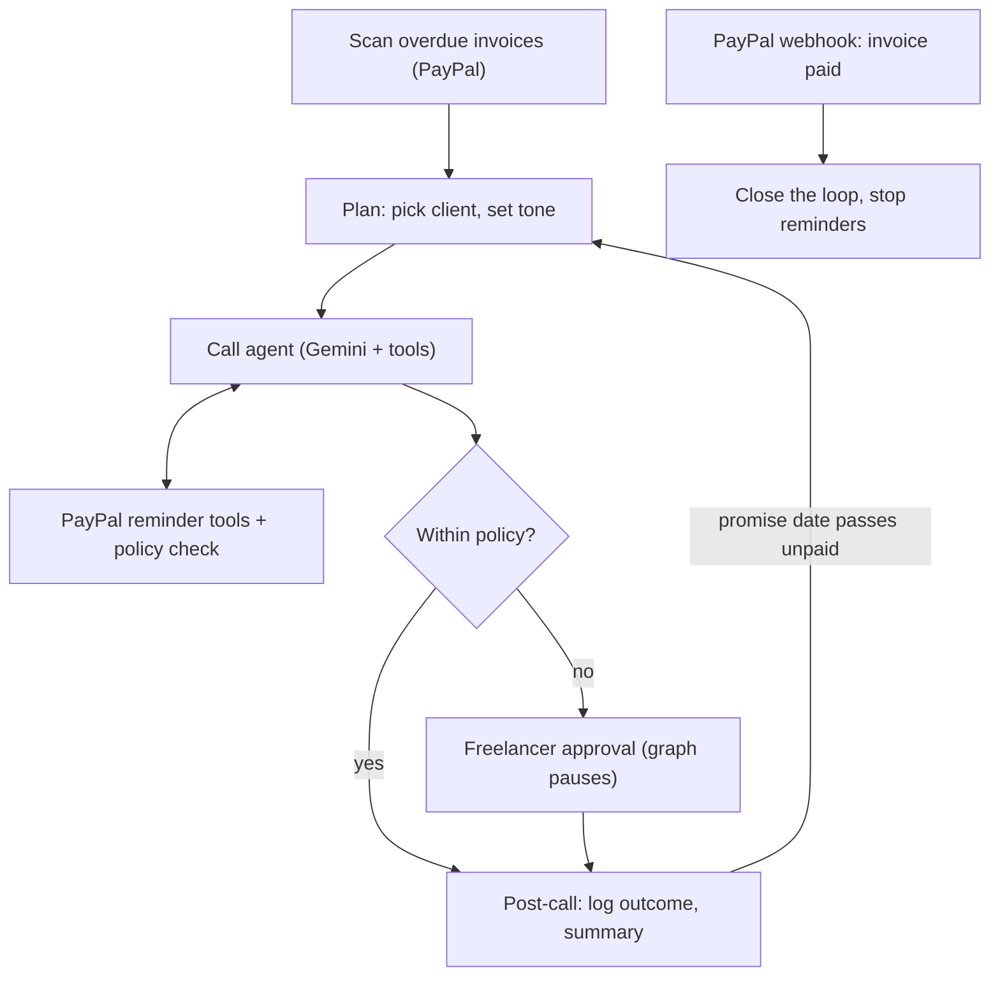

# FreeVoice

**An AI collections agent for freelancers, built on PayPal.**

Chasing late invoices is awkward, slow and easy to put off. FreeVoice is an AI assistant that does the chasing: it works through overdue PayPal invoices, talks to each client, negotiates inside limits the freelancer sets, and escalates to the freelancer only when a client asks for something outside those limits. When the client pays, PayPal tells the app and the chasing stops.

Built for the PayPal AI Hackathon. This is a new project, started during the submission period.

**Live demo:** https://collections-agent-web.onrender.com
(The free server sleeps when idle, so the first load can take about a minute.)

## What it does

- **Finds overdue invoices** in the PayPal sandbox and picks a tone based on how late they are (friendly, firm, urgent).
- **Calls the client** (a browser call with voice or typing). The assistant says it is an AI, keeps replies short, and asks for payment or a firm date.
- **Negotiates inside a policy** (`backend/policy.yaml`): maximum extension days and discount percent. Anything outside the limits makes the assistant ask the client to hold, and the **graph pauses for the freelancer**, who approves or denies on the dashboard. The assistant then returns with the decision.
- **Records promises with real dates.** "The 4th" means the next 4th, the date is read back to the client, and past dates are rejected in code.
- **Sends a PayPal payment reminder** with the pay link when the client agrees to pay.
- **Retries missed calls** (ring, retry after a delay, give up after the limit and send a reminder by email).
- **Follows up on broken promises.** When a promised date passes unpaid, a new call goes out, and the assistant mentions the earlier promise.
- **Handles disputes.** If a client says the work was not delivered or the amount is wrong, collection stops, the invoice is flagged for the freelancer, and it stays paused until they mark it resolved.
- **Closes the loop when money lands.** PayPal's `INVOICING.INVOICE.PAID` webhook (signature verified) marks the invoice paid and stops all further calls.
- **Gives the freelancer a dashboard:** an AG Grid table of invoices, a live call monitor, an approval queue, one-sentence summaries of every call, and recovery analytics (recovery rate, time to pay, promises kept vs broken).

## How PayPal and AI are used

| Area | What we use |
|---|---|
| PayPal Invoicing API | Create, send, list and fetch invoices, and send payment reminders |
| PayPal Agent Toolkit (LangChain) | The reminder and QR tools the agent can call itself. The agent is deliberately **not** given tools to create or cancel invoices |
| PayPal Webhooks | `INVOICING.INVOICE.PAID`, verified with PayPal's signature verification endpoint |
| Gemini (`gemini-3.5-flash`) | The conversation, tool calling, and judgment calls such as telling a dispute from a delay |
| LangGraph | A stateful agent graph with human-in-the-loop `interrupt()` for owner approval, checkpointed in SQLite so a paused call can resume across requests (on a free host the database resets when the server restarts) |
| AG Grid | The invoice table on the freelancer dashboard |
| Render | Hosting for the API (Python web service) and the dashboard (static site) |

### Architecture



### Guardrails

- The assistant always says it is an AI and never threatens the client.
- Limits live in `policy.yaml`, and out-of-policy requests are never approved by the model. They always go to the freelancer.
- The agent can only send reminders and QR codes through PayPal. It cannot create, edit or cancel invoices.
- Dates are validated in code, not just in the prompt.
- Disputed invoices are never chased until the freelancer resolves them.

## Try it (about 3 minutes)

1. Open the live demo and wait for the dashboard to load.
2. Click **Open** on an overdue invoice, then **Start call**.
3. Click **Open as client** and press **Answer**. Use Chrome and allow the microphone, or just type.
4. Say: *"Can I get 30 more days?"* The assistant asks you to hold. Switch to the dashboard tab, and under **Freelancer approvals** click **Approve** or **Deny**. Back in the client tab, the assistant returns with the decision. Confirm a date.
5. Try a dispute on another invoice: *"I never received the final files."*
6. Pay an invoice to see the loop close. Log in at https://sandbox.paypal.com with the test client account below and pay the invoice. The row turns green on the dashboard within seconds.
7. On a promised invoice, click **Demo: the promised date passes** to see a follow-up call.

**Sandbox test accounts** (for paying invoices):

- Client (personal) account email: sb-67gbf53364564@personal.example.com
- Password: iS*=32@x

## Run it locally

You need Python 3.12 or newer, Node 20 or newer, a free PayPal developer account, and a free Gemini API key from Google AI Studio.

**1. PayPal sandbox setup**

1. In the PayPal Developer Dashboard (Sandbox mode), create a **Business** sandbox account and a **Personal** sandbox account. Use the United States as the country, since some features are limited elsewhere.
2. Create an app linked to the business account and enable **Invoicing** under its features.
3. Copy the app's client ID and secret.

**2. Backend**

```bash
git clone https://github.com/shriyaagg/FreeVoice.git
cd FreeVoice
python3 -m venv .venv
source .venv/bin/activate
pip install -r requirements.txt
cp .env.example .env      # then fill in your keys
uvicorn backend.main:app --reload
```

**3. Frontend** (in a second terminal)

```bash
cd frontend
npm install
npm run dev
```

Open http://localhost:5173. The dashboard reads invoices from your sandbox. Create some with the **+ New invoice** button (choose "days overdue" to backdate the due date), or run `python -m scripts.seed_invoices` from the repo root.

**Environment variables**

| Variable | Purpose |
|---|---|
| `PAYPAL_CLIENT_ID`, `PAYPAL_SECRET` | Your sandbox app credentials |
| `GOOGLE_API_KEY` | Gemini API key |
| `LLM_MODEL` | Defaults to `gemini-3.5-flash` |
| `MOCK_LLM` | `1` swaps in a scripted stand-in agent for UI development without an API key. **Keep it `0`** for real use |
| `DEMO_MODE` | `1` shows the "promised date passes" demo button |
| `PAYPAL_WEBHOOK_ID` | Enables webhook signature verification. Needs a public URL, so it is optional locally (the dashboard also reads PayPal's invoice status directly) |
| `FRONTEND_URL` | The dashboard's origin, for CORS |

## Configuring the agent

`backend/policy.yaml`:

```yaml
max_extension_days: 14
max_discount_percent: 5
max_calls_per_invoice: 3
max_followups: 2
ring_timeout_seconds: 20
retry_delay_minutes: [0.5, 1]
```

The ring and retry values are tuned for a short demo. In production they would be minutes and hours.

## Notes on the hosted demo

- **Cold starts:** the free Render server sleeps after about 15 minutes idle. Open the dashboard and wait a minute.
- **Retries and follow-up calls** run in a background loop, so they only fire while the server is awake.
- **Call history resets** whenever the server restarts or redeploys, because it uses SQLite on a free instance. Your PayPal invoices are not affected.
- **LLM quota:** the hosted demo uses a free Gemini key. If you see "Agent error", the quota may be used up, so wait a minute or run it locally with your own key.

## Limitations and next steps

- Calls run in the browser (voice or typing). The link-based design is where a telephony provider such as a phone-call API would plug in, and the missed-call, retry and follow-up logic is already in place for it.
- An approved discount is agreed during the call, but it is not yet applied to the PayPal invoice.
- A client's request is held while the freelancer decides. In production the call would end and the assistant would call back with the answer.
- Summaries are built from structured call data. An LLM-written summary would be a natural upgrade.

## License

MIT, see [LICENSE](LICENSE).
